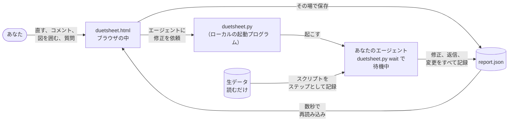

<h1 align="center">Duetsheet</h1>

<p align="center"><b>人と AI エージェントが同じ楽譜で演奏し、一手ずつ記録し、もう一度演奏できるシート。</b><br>あなたと AI エージェントがラウンドを重ねて一緒に見直し、直していくインタラクティブなレポート。<br>その場で直す、図の上で囲む、読みながら質問する。すべての変更が、誰が行ったかとともに残ります。</p>

<p align="center">
  <a href="LICENSE"></a>
  <a href="#インストール"></a>
  <a href="duetsheet.html"></a>
  <a href="#インストール"></a>
  <a href="AGENTS.md"></a>
  <a href="CITATION.cff"></a>
</p>

<p align="center">
  <a href="docs/tutorial.md"></a>
  &nbsp;
  <a href="https://github.com/Ashur5457/duetsheet/archive/refs/heads/main.zip"></a>
  &nbsp;
  <a href="#インストール"></a>
</p>

<p align="center"><a href="README.md">English</a> · <a href="README.zh-Hant.md">繁體中文</a> · <b>日本語</b></p>

<p align="center">
  <a href="#クイックスタート">クイックスタート</a> ·
  <a href="#画面">画面</a> ·
  <a href="#しくみ">しくみ</a> ·
  <a href="#機能">機能</a> ·
  <a href="#インストール">インストール</a> ·
  <a href="#エージェント向け">エージェント向け</a> ·
  <a href="#よくある質問">よくある質問</a> ·
  <a href="#制限">制限</a> ·
  <a href="#ロードマップ">ロードマップ</a>
</p>

<p align="center">
  
</p>

<p align="center"><sub>読みながら質問：2 点を囲み、質問を選んで送ると、エージェントの回答が質問パネルに戻ってきます。デモプロジェクト、合成データ。</sub></p>

---

AI エージェントは「それらしく見える」レポートを書くのが得意です。難しいのは、どこが違うのかを正確に伝えることです。チャット欄に「2 枚目の図の左上の点の集まりがおかしい」と書いても曖昧で、何往復かするうちに、どれが最新版なのか誰にも分からなくなります。

Duetsheet はチャット欄の代わりにレポートそのものを使います。内容をその場で直し、指したい点を図の上で囲み、読んでいる段落についてそのまま質問できます。エージェントが受け取るのは、正確なデータ範囲、行の ID、変更前後の値です。エージェントは修正し、コメントごとに返信します。すべての変更は誰が行ったかとともに記録され、どの図も、それを作った元ファイルとスクリプトまでたどれます。

名前の由来：二重奏（duet）では、二人の奏者が**同じ一枚の楽譜**を見て演奏します。ここでは人と AI エージェントが同じページで作業し、楽譜と同じように、その手順をもう一度**演奏**できます。

> [!NOTE]
> **v0.7 プロトタイプ。** Claude Code で `/duetsheet` と入力するか、データフォルダで `python duetsheet.py` を実行して起動します。Chrome か Edge で `duetsheet.html` を開いてフォルダを選ぶ、[Claude](https://claude.ai) の Artifact として公開する、保存したレポートファイルを任意のブラウザで使う、という方法もあります。

> [!TIP]
> **レポートだけでなく、研究の全体を残したいなら。** [Duetkifu](https://github.com/Ashur5457/duetkifu) は、レポートに至るまでのすべての試み（行き止まりも含めて）を、あなたとエージェントが一緒に書き、再計算できるツリーとして記録します。Duetsheet の上に作られており、同じ `report.json` を読みます。

## クイックスタート

[Claude Code](https://code.claude.com/docs/en/overview) と Python 3.8 以上があれば十分です（ほかに何もインストールしません）。

```text
/plugin marketplace add Ashur5457/duetsheet
/plugin install duetsheet@duetsheet
```

次に、生データのあるフォルダで Claude Code を開き、こう入力します。

```text
/duetsheet このフォルダのデータからレポートを書いて
```

Claude は [`AGENTS.md`](AGENTS.md) を読み、構成案を示し、あなたが同意してからレポートを書き、チェックしたうえで、フォルダにつながった状態でブラウザに開きます。見直したら **エージェントに修正を依頼** を押してください。バックグラウンドで待っている Claude があなたのコメントを処理し、ページは自動で再読み込みされます。

Claude Code がない場合は、デスクトップ版、ほかのエージェント、エージェントなしの使い方を[インストール](#インストール)にまとめています。[チュートリアル](docs/tutorial.md)（英語）では、スクリーンショット付きで 1 ラウンドを通して説明しています。

## 画面

<table>
  <tr>
    <td width="50%"></td>
    <td width="50%"></td>
  </tr>
  <tr>
    <td><sub><b>データそのものを指す。</b>点を手書きで囲むか 1 点をクリック。コメントにはピクセルではなく、データ範囲と行 ID が記録されます。</sub></td>
    <td><sub><b>エージェントが答える。</b>コメントごとに返信。Figure 1 は対数軸になり、続けて返信もできます。</sub></td>
  </tr>
  <tr>
    <td></td>
    <td></td>
  </tr>
  <tr>
    <td><sub><b>すべての変更と、その作者。</b>インライン差分、ラウンド、タイムライン。あなたの変更は青、エージェントは紫。</sub></td>
    <td><sub><b>データチェーン。</b>どのグラフも、作ったスクリプトを通って元ファイルまで、指紋付きでたどれます。</sub></td>
  </tr>
  <tr>
    <td></td>
    <td></td>
  </tr>
  <tr>
    <td><sub><b>1 ページは 1 枚のスライド。</b>動かす、大きさを変える。どの画面でも、1 ページに入るブロックは同じです。</sub></td>
    <td><sub><b>いつでも自動保存。</b>変更はその場で書き込まれ、自分の変更は元に戻す・やり直すで取り消せます。</sub></td>
  </tr>
</table>

ほかの画面は[チュートリアル](docs/tutorial.md)に：[質問パネル](docs/view-ask.png)、[ファイルメニュー](docs/file-menu.png)、[スタイルの提案](docs/style-panel.png)、[日本語の画面](docs/language-ja.png)。

## しくみ



ページ自体は AI モデルを呼びません。決まった閲覧・編集画面にすぎず、レポートはどのエージェントでも読み書きできる普通の JSON 文書として保存されます。

| コレクション | 中身 |
|---|---|
| `report/meta`、`blocks` | タイトル、ブロックの順序、ブロック（`text`、`chart`、`table`、`image`、`outline`） |
| `datasets` | 元ファイルと SHA-256 付きのデータ表。グラフと表は値をコピーせず、これを参照します |
| `annotations` | あなたのフィードバック：どこを指すか（ブロック、引用、データ点、矩形や手書きの範囲）、タグ、本文、状態、エージェントとのやり取り |
| `changes`、`rounds` | 変更した項目ごとに 1 件の記録（変更前、変更後、誰が、いつ）と、ラウンドの区切り |
| `steps` | データチェーン：実行した各スクリプトとその入出力ファイル。どのデータ表も元ファイルまでたどれます |
| `style`、`examples` | 図のスタイルと文章のルール、エージェントが提案してあなたの確認を待つもの |

同じ文書は、フォルダの `report.json`、Claude Artifact のデータベース、保存したレポートファイルのどこにでも置けます。中身がデータなので、エージェントはレポート全体を作り直さずに、キャプション 1 つやグラフの設定 1 つだけを変えられ、どの変更も誰のものか分かり、元に戻せます。

## 機能

| | |
|---|---|
| **読む** | 16:9 のページ。同じ幅で組んで、スライドのように全体を拡大縮小。ページは動かせて、大きさも変えられます。図と説明を横に並べ、ページ番号付きの目次ブロックも作れます。 |
| **読みながら質問** | 図の一部を囲む、データ点をクリックする、文章を選択する、それだけで質問できます。質問は浮かぶパネルにたまり、ボタン 1 つで送られ、回答もそこに戻ってきます。 |
| **見直す** | タイトル、本文、キャプション、グラフの設定をその場で直します。各ブロックの下にコメント。タグは 2 段で、質問（*どう計算した？*）と修正（*対数目盛にする*）。グラフと画像は矩形や手書きで囲めます。 |
| **エージェントに渡す** | **エージェントに修正を依頼** でバックグラウンドのエージェントを起こし、進み具合を表示し、修正されたレポートを再読み込みします。待っているエージェントがいなければ、貼り付け用のプロンプトを出します。 |
| **履歴** | すべての変更に変更前後の値、あなたかエージェントか。インライン差分、ラウンド、タイムライン。どの変更も個別に元に戻せます。自分の変更は元に戻す・やり直す、ファイルメニューからスナップショット。 |
| **データ** | CSV、TSV、JSON をパスと SHA-256 付きで取り込み。データチェーンが各グラフをスクリプト経由で元ファイルにつなぎ、元が変わればそこから計算したものがすべて赤になります。 |
| **スタイル** | 自分の SVG や `.mplstyle` から図のスタイルを、自分の文章から書き方のルールを学習。チェックを入れるまで何も変わりません。 |
| **誰にでも** | 6 つの表示言語、自分で追加も可能。HTML ファイル 1 つの閲覧専用コピー。問題は ⚠ の下に並び、エージェントにも伝わります。 |

<details>
<summary><b>すべての機能の詳細</b></summary>

<br>

**見直す**
- **閲覧**：自動で改ページされる 16:9 のページ。どのブロックも「新しいページから」「前のブロックの下に続ける」「前のブロックの横に置く」に設定でき、図とその説明を横に並べられます。目次ブロックは章と図をページ番号付きのリンクで並べます。1 ページに収まらないときは図が自動で縮みます。ページは常に同じ幅で組んで全体を拡大縮小するので、どの画面でも 1 ページに入るブロックは同じです。上の細いバーでページを動かし、右下の角で大きさを変えます。
- **読みながら質問**：閲覧モードで、図の一部を囲む、データ点をクリックする、文章を選択すると、エージェントに質問できます。質問（`from: "view"` として保存）は浮かぶパネルにたまり、ボタン 1 つで送られ、回答もそこに戻り、続けて返信できます。質問のタグ（*データの出どころは？*、*どう計算した？*、*信頼できる？*）には、修正ではなく回答が返ってきます。
- **編集**：タイトル、本文、キャプションをその場で直す。グラフの種類、軸、範囲、対数目盛を変える。画像を切り抜き、拡大縮小する。ブロックをドラッグで並べ替え、または **順序を整理（タイトルのみ）** でページごとに 1 行ずつ見る。ブロックの追加と削除。サイドパネルは右側に固定するか、ページの上に浮かせます。
- **図への書き込み**：お絵かきソフトのように手書きで囲む、または矩形で選ぶ。グラフでも画像でも使え、データ点 1 つをクリックすることもできます。グラフでは、ピクセルではなく**データ座標の範囲と囲んだデータ点**が記録されます。
- **設定ではなく言葉で**：どのコメント欄にも **依頼の例** があり、科学でよく使う文から書き始められます（対数目盛、軸の範囲、複数系列、R² 付きの近似線、誤差棒、相関を平易に説明）。[…] は自分で埋める部分です。フォルダタブでチェックしたファイルを添付できます。
- **コメントでの会話**：エージェントはコメントごとに返信し、あなたも返信できます。返信するとそのコメントは再び開き、次のラウンドで扱われます。

**履歴**
- **変更履歴**：すべての編集に変更前後の値。文章はインライン差分、設定は文（「Y 軸：線形 → 対数」）で表示。どの変更も個別に元に戻せます。
- **ラウンドとタイムライン**：ボタン 1 つでラウンドを閉じます。タイムラインはブロック×ラウンドで、人とエージェントの編集を色分けします。
- **いつでも自動保存**：変更はその場で書き込まれ、上部バーに時刻が出ます。元に戻す・やり直す（Ctrl+Z、Ctrl+Y）で、今のラウンドの自分の変更を取り消せます。ファイルメニューでは、`report.json` を日付付きで `exports/snapshots/` に残す、書き出す、コメントを消す（先にスナップショットを保存）ができます。

**データと図**
- **データフォルダの中で動く**：レポートは `duetsheet/` サブフォルダに保存し、生データは読むだけです。ページを開いたままでもエージェントはレポートを編集でき、ページは再読み込みして文書単位でマージします。
- **出どころ付きの生データ**：各データ表にファイルのパスと SHA-256 の指紋を記録し、取り込み後にファイルが変わればページが知らせます。
- **図から元ファイルまでのデータチェーン**：実行したスクリプトはすべてステップとして記録されます。各グラフの下の *Source: cells.csv ← make_cells.py ← 72 raw files* のような 1 行から、チェーン全体が開きます。元ファイルやスクリプトが変わると、そこから計算したものがすべて赤くなり、ステップの入力パターンに合う新しいファイルは自動で見つかります。フォルダタブはすべてのファイルをファイルブラウザのように開閉できるフォルダで並べ、名前で絞り込め、逆向きの問い（この元ファイルを使っているグラフはどれか）にも答えます。
- **1 つのグラフに複数系列**、**ファイル名を打たずにチェックで選ぶ**（フォルダタブでチェックし、グラフへの追加や差し替えをエージェントに依頼）、**どんなツールの図でも**（SVG はベクターのまま、Origin、matplotlib、MATLAB、R などの PNG/JPEG も。ツール、スクリプト、生データを記録）。

**あなたのスタイル**
- **スタイル設定**：フォント、ポイント単位の文字サイズ、マーカー、線幅、目盛、枠、グリッド、配色、図の幅のプリセット（自由、ACS 1 段・2 段）。matplotlib の `.mplstyle` として書き出せます。
- **習慣を学ぶ**：図と `.mplstyle` を `habits/figures/` に、自分の文章を `habits/writing/` に置きます。提案ごとに根拠のファイルが示されます。個人の習慣として一度保存すれば、どのプロジェクトでも読み込めます。

**誰にでも**
- **ページのすべての部分に名前**：ヘルプ画面に一覧があり、あなたとエージェントが同じものを指して話せます。
- **見える問題**：エラーと警告は **⚠** の下に並び、エージェントにも送られ、`errors.log` に保存されます。`NaN` と `Infinity` は空の値として読み込み、保存の失敗（OneDrive がファイルを使っている間など）は再試行します。
- **6 つの表示言語、さらに自分の言語も**：英語、繁体字中国語、簡体字中国語、日本語、韓国語、スペイン語。メニューから言語を追加・修正できます（[方法](docs/translating.md)）。
- **閲覧専用コピーとショートカット**：**ファイル > 閲覧専用コピーを書き出す** で、どこでも開ける HTML ファイルが 1 つできます。`python duetsheet.py shortcut <フォルダ>` でデスクトップにショートカットを置けます。

</details>

## インストール

必要なのは **Python 3.8 以上** だけです。Duetsheet は AI モデルを呼ばず、API キーも要りません。

| 環境 | 方法 |
|---|---|
| ターミナル、VS Code、JetBrains の **Claude Code** | `/plugin marketplace add Ashur5457/duetsheet` のあと `/plugin install duetsheet@duetsheet` |
| **Claude デスクトップ版**（プラグインマーケットプレイスを追加できない） | `git clone https://github.com/Ashur5457/duetsheet.git && python duetsheet/duetsheet.py install-skill` |
| **ほかのエージェント**（Codex、Copilot、Cursor、Gemini CLI、Cline） | リポジトリを取得し、データフォルダごとに 1 回：`python duetsheet.py init-agent "<データフォルダ>"` |
| **エージェントなし** | `python duetsheet.py "<データフォルダ>"`、または Chrome か Edge で `duetsheet.html` を開き **プロジェクトフォルダを開く** |
| **claude.ai の Claude** | `duetsheet.html` をアップロードし、`db`、`assets`、`sample`、`downloads` の機能付きで Artifact として公開するよう Claude に頼む |

<details>
<summary><b>ファイルの置き場所</b></summary>

<br>

生データは、開くフォルダの**中**、ただし `duetsheet/` の**外**に置きます。サブフォルダは自由です。そこから計算したものはすべて `duetsheet/` の中に入ります。

```text
my-experiment/                開くフォルダ
  Data_R1/run001.xlsx         生データ：元の場所のまま、読むだけ
  notes/instrument.csv
  duetsheet/                  Duetsheet が作る
    report.json               レポート
    derived_data/cells.csv    生データから計算した表
    scripts/make_cells.py     それを計算するスクリプト
    exports/snapshots/        保存したスナップショット
```

開いたフォルダの外にあるデータはたどれません。先に移動するかコピーしてください。

</details>

<details>
<summary><b>更新、削除、git なしでのインストール</b></summary>

<br>

- **プラグイン**：`/plugin marketplace update duetsheet` で更新し、新しいセッションを開始。`/plugin uninstall duetsheet@duetsheet` で削除。
- **コピーから入れたスキル**：`duetsheet` フォルダで `git pull` し、もう一度 `python duetsheet.py install-skill`。削除は `~/.claude/skills/duetsheet` を消すだけ。
- **git なし**：[ZIP をダウンロード](https://github.com/Ashur5457/duetsheet/archive/refs/heads/main.zip)して展開し、そのフォルダで `python duetsheet.py install-skill`。
- `init-agent` はデータフォルダの `AGENTS.md` と `CLAUDE.md` に目印付きの一節を加えます。ファイルのほかの内容はそのまま残ります。

</details>

<details>
<summary><b>Python なしで、または Firefox や Safari で</b></summary>

<br>

Chrome か Edge で [`duetsheet.html`](duetsheet.html) を開き、**プロジェクトフォルダを開く** を押します。デモを試すなら [`examples/demo-project`](examples/demo-project) を選んでください。Firefox と Safari はページからフォルダを開けません。起動プログラムを使うか、**レポートファイルを保存** と **レポートファイルを開く** を使ってください。

</details>

## エージェント向け

Duetsheet はモデルを呼びません。エージェントはレポートを JSON として読み書きします。

| ファイル | 内容 |
|---|---|
| [`AGENTS.md`](AGENTS.md) | データモデル、`report.json` を安全に書く方法、各タスク：コメントに沿った修正、質問への回答、データの取り込み、図と文章の習慣の学習、新しいレポートの作成（英語） |
| [`duetsheet.py`](duetsheet.py) | 起動プログラム（`python duetsheet.py <フォルダ>`）、`check`、データチェーンを記録する `step`、見直しの流れで使う `annotations`、`wait`、`agent-status`、そして `shortcut`、`init-agent`、`install-skill` |
| [`skills/duetsheet/SKILL.md`](skills/duetsheet/SKILL.md) | Claude Code の `/duetsheet` スキル |
| [`schema/report.schema.json`](schema/report.schema.json) | レポートの JSON Schema |
| [`examples/demo-project/`](examples/demo-project/) | 小さなデータチェーン付きの完全なプロジェクトフォルダ（合成データ） |
| [`llms.txt`](llms.txt) | LLM 向けの短い索引 |

<details>
<summary><b>よく効くプロンプト</b></summary>

<br>

```text
AGENTS.md に従い、このフォルダのデータファイルから Duetsheet のレポートを書いて。各データ表の出どころを記録し、duetsheet.py check で確認してから Duetsheet を起動して。
```

```text
report.json の未対応のコメントを読んで。それぞれ最小限の修正をし、changes に記録し、コメントの下に返信して、最後に自分のラウンドを閉じて。
```

```text
habits/ にある私の図を見て、スタイルの提案を style/proposal に書いて。style/profile は変えないで。
```

</details>

## こんな人に

**AI がデータの多いレポートを下書きし、専門家が主張を 1 つずつ確かめる**、あらゆる仕事に：科学データの解析と実験レポート（このプロジェクトの出発点は閉ループの材料実験です）、株式調査や監査調書、故障解析や品質調査、コンサルティングや市場調査、ファクトチェック、事後検証や設計レビュー。文章だけのレポートなら、文書エディタの提案モードで足りるかもしれません。Duetsheet が最も役立つのは、レポートに**データに基づくグラフ**があり、どの数字もたどれる必要があるときです。

## よくある質問

<details>
<summary><b>Claude やアカウントは必要ですか？</b></summary>

<br>

いいえ。自分のコンピュータで、起動プログラム（どのブラウザでも）か Chrome・Edge だけでレポートをフォルダに保存でき、ファイルを編集できるエージェントならどれでも使えます。Claude Code と Claude Artifact は対応している使い方の一つで、必須ではありません。

</details>

<details>
<summary><b>データはどこに保存されますか？</b></summary>

<br>

データフォルダ（Duetsheet 自身のファイルは `duetsheet/` サブフォルダ）、Claude Artifact、または保存したファイルです。Duetsheet にオンラインサービスはなく、どこにも何も送りません。起動プログラムは自分のコンピュータ（127.0.0.1）だけで待ち受け、ランダムなトークンが必要です。ページは Google Fonts からフォントを、CDN から小さなライブラリ（SortableJS）を 1 つ読み込みます。

</details>

<details>
<summary><b>どのデータ点を指しているか、エージェントはどう分かるのですか？</b></summary>

<br>

グラフで点をクリックしたり、矩形や手書きで囲んだりすると、画面のピクセルではなく、グラフのデータ単位での範囲と、中に入った行の ID が記録されます。

</details>

<details>
<summary><b>元ファイルが変わったとき、どのグラフに影響するか分かりますか？</b></summary>

<br>

各グラフと表に、データチェーンの状態を示す点があります。すべてのファイルが記録どおりなら緑、元ファイル・スクリプト・派生ファイルが変わっていれば赤です。フォルダタブで元ファイルやフォルダをクリックすると、それに依存するものが並びます。`python duetsheet.py check <フォルダ>` も同じ内容を警告として出します。

</details>

<details>
<summary><b>Origin、matplotlib、MATLAB、R の図は使えますか？</b></summary>

<br>

はい。SVG か PNG をアップロードし、ツール、元のファイル、描画スクリプト、生データを記録します。画像上の矩形や手書きの範囲は、今のところ画像に対する相対位置で保存されます。データ座標への変換はロードマップにあります。

</details>

<details>
<summary><b>Google ドキュメントや Word のコメント、Jupyter や Quarto とは何が違いますか？</b></summary>

<br>

文書のコメントが指すのは文章です。Duetsheet のコメントはグラフ上のデータ点や範囲を指せ、見直しの経過全体が、エージェントがそのまま扱える構造化データになります。Jupyter と Quarto はコードからレポートを作ります。Duetsheet は、何で作られたレポートであっても、人とエージェントが一緒に見直して直す場所です。

</details>

## 制限

- ページから直接フォルダを開くには Chrome か Edge が必要です。起動プログラムを使えば、最近のブラウザならどれでも動きます。デスクトップのブラウザ向けに設計しています。
- Claude Artifact では、文書 1 つあたり約 256 kB、レポート 1 つあたり約 5,000 文書が上限です。アセットストアがないとき、アップロードした画像は約 230 kB に圧縮されます。
- 矩形や手書きで囲めるのはグラフと画像だけです。文章と表は、ブロックへのコメントと引用で扱います。
- PNG と JPEG の図はページでは測れません。エージェントに見てもらうか、SVG を使ってください。Excel や装置のファイルはエージェントが変換し、ページでは直接取り込みません。
- 表示言語はレポートの内容までは翻訳しません。右から左に書く言語も読み込めますが、レイアウトは左から右のままです。

## ロードマップ

- 「LLM 向けのフィードバックをコピー」するプロンプトを 1 クリックで書き出す
- Claude Artifact の中で、起動プログラムなしにページからエージェントを起こす
- デスクトップのショートカットで起動するエージェント。プロンプトを貼らなくても **エージェントに修正を依頼** が動くように
- 元から図を作り直す：記録されたスクリプトを実行する、または Python API で Origin を操作する
- 取り込んだ画像の軸の校正。Origin や matplotlib の画像上の範囲をデータ座標で保存
- **ワークフローモード**：再計算が必要なステップをページから実行し直す
- 自動実験室の物理的な実験ステップ。人の明示的な承認があるときだけ実行
- コメントと変更履歴をエージェント評価用のデータセットに

研究の分岐、行き止まり、すべての試みの記録は [Duetkifu](https://github.com/Ashur5457/duetkifu) にあります。

## 貢献

Issue とプルリクエストを歓迎します。特に、ほかの分野のレポートの種類や書き込みのニーズ、翻訳を。英語以外の表示テキストと、中国語版・日本語版の README は AI の助けを借りて下書きしました。ネイティブスピーカーによる修正を大いに歓迎します。

- `duetsheet.html` が唯一のソースファイルです。ビルドはありません。編集してブラウザで開くだけです。
- 新しい表示テキストは `tr('English text')` で書き、翻訳表に項目を加えます（[docs/translating.md](docs/translating.md)）。英語の README を変えたら、[`README.zh-Hant.md`](README.zh-Hant.md) と [`README.ja.md`](README.ja.md) も一緒に変えてください。
- プルリクエストの前に、`python tools/check.py`（コードが英語か、翻訳表が正しいか、Node.js での JavaScript の構文）、`python tests/test_chain.py`、`python tests/test_agent.py` を実行してください。テストは一時フォルダとデモプロジェクトだけを使い、あなたのデータには触れません。

## 引用

研究で Duetsheet を使った場合は、[`CITATION.cff`](CITATION.cff) に従って引用してください（GitHub に「Cite this repository」ボタンがあります）。

## ライセンス

[MIT](LICENSE)
