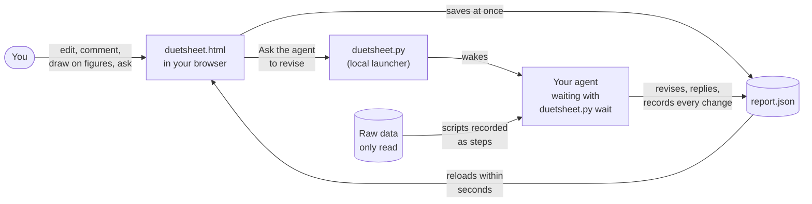

<h1 align="center">Duetsheet</h1>

<p align="center"><b>The sheet humans and AI agents play from together, record every move on, and rerun.</b><br>An interactive report that you and your AI agent review and revise together, round after round.<br>Edit in place, draw on the figures, ask while you read; every change is kept with who made it.</p>

<p align="center">
  <a href="LICENSE"></a>
  <a href="#install"></a>
  <a href="duetsheet.html"></a>
  <a href="#install"></a>
  <a href="AGENTS.md"></a>
  <a href="CITATION.cff"></a>
</p>

<p align="center">
  <a href="docs/tutorial.md"></a>
  &nbsp;
  <a href="https://github.com/Ashur5457/duetsheet/archive/refs/heads/main.zip"></a>
  &nbsp;
  <a href="#install"></a>
</p>

<p align="center"><b>English</b> · <a href="README.zh-Hant.md">&#32321;&#39636;&#20013;&#25991;</a> · <a href="README.ja.md">&#26085;&#26412;&#35486;</a></p>

<p align="center">
  <a href="#quick-start">Quick start</a> ·
  <a href="#gallery">Gallery</a> ·
  <a href="#how-it-works">How it works</a> ·
  <a href="#features">Features</a> ·
  <a href="#install">Install</a> ·
  <a href="#for-agents">For agents</a> ·
  <a href="#faq">FAQ</a> ·
  <a href="#limits">Limits</a> ·
  <a href="#roadmap">Roadmap</a>
</p>

<p align="center">
  
</p>

<p align="center"><sub>Asking while reading: draw around two points, pick a question, send it; the agent's answer comes back into the questions panel. Demo project, synthetic data.</sub></p>

---

AI agents are good at producing reports that *look* right. The hard part is telling them precisely what is wrong. "The cluster in the upper left of the second figure looks off" is vague in a chat box, and after a few rounds nobody knows which version is current.

Duetsheet replaces the chat box with the report itself. You edit it directly, draw around the points you mean, or ask about a passage while you read; the agent receives exact data ranges, row ids and before/after values, revises, and answers under each comment. Every change is recorded with who made it, and every figure can be traced back to the raw files and scripts behind it.

Why the name: in a duet, two performers play from **one sheet of music**. Here a human and an AI agent work from one shared page, and like sheet music, its steps can be **played** again.

> [!NOTE]
> **v0.7 prototype.** Start it from Claude Code (`/duetsheet`) or with `python duetsheet.py` in your data folder; open `duetsheet.html` in Chrome or Edge and choose a folder; host it as a [Claude](https://claude.ai) Artifact; or use saved report files in any browser.

> [!TIP]
> **Keeping the whole research, not only the report?** [Duetkifu](https://github.com/Ashur5457/duetkifu) records every attempt that led to a report, the dead ends included, as a tree you and your agent write together and can recompute. It builds on Duetsheet and reads the same `report.json`.

## Quick start

With [Claude Code](https://code.claude.com/docs/en/overview) and Python 3.8 or later (nothing else to install):

```text
/plugin marketplace add Ashur5457/duetsheet
/plugin install duetsheet@duetsheet
```

Then open Claude Code in the folder that holds your raw data and type:

```text
/duetsheet write a report from the data in this folder
```

Claude reads [`AGENTS.md`](AGENTS.md), proposes an outline, writes the report after you agree, checks it, and opens it in your browser, already connected to the folder. Review it, click **Ask the agent to revise**, and Claude, waiting in the background, handles your comments; the page reloads by itself.

No Claude Code? See [Install](#install) for the desktop app, other agents, or no agent at all. The [tutorial](docs/tutorial.md) walks through one round with screenshots.

## Gallery

<table>
  <tr>
    <td width="50%"></td>
    <td width="50%"></td>
  </tr>
  <tr>
    <td><sub><b>Point at the exact data.</b> Draw around points free-hand or click one; the comment stores the data range and the row ids, not pixels.</sub></td>
    <td><sub><b>The agent answers.</b> Each comment gets a reply; Figure 1 is now on a log axis, and you can answer back.</sub></td>
  </tr>
  <tr>
    <td></td>
    <td></td>
  </tr>
  <tr>
    <td><sub><b>Every change, by whom.</b> Inline diffs, rounds and a timeline; yours in blue, the agent's in purple.</sub></td>
    <td><sub><b>The data chain.</b> Every chart traced through the scripts that made it back to its raw files, with fingerprints.</sub></td>
  </tr>
  <tr>
    <td></td>
    <td></td>
  </tr>
  <tr>
    <td><sub><b>A page is a slide.</b> Move it, resize it; it always holds the same blocks, on every screen.</sub></td>
    <td><sub><b>Saved as you go.</b> Every change is written at once; Undo and Redo take back your own.</sub></td>
  </tr>
</table>

More in the [tutorial](docs/tutorial.md): the [questions panel](docs/view-ask.png), the [File menu](docs/file-menu.png), [style suggestions](docs/style-panel.png), the [Japanese interface](docs/language-ja.png).

## How it works



The page never calls a model. It is a fixed viewer and editor; the report lives as plain JSON documents that any agent can read and write:

| Collection | What it holds |
|---|---|
| `report/meta`, `blocks` | Title, block order, and the blocks: `text`, `chart`, `table`, `image`, `outline` |
| `datasets` | Data tables with their source file and SHA-256; charts and tables reference them instead of copying values |
| `annotations` | Your feedback: what it points at (a block, a quote, a data point, a box or a free-hand region), tags, text, status, and the conversation with the agent |
| `changes`, `rounds` | One record per edited field (before, after, who, when), and the boundaries between rounds |
| `steps` | The data chain: each script run with its input and output files, so every dataset can be traced back to raw files |
| `style`, `examples` | Your figure style and writing rules, and suggestions an agent made for you to confirm |

The same documents live in `report.json` in your folder, in the database of a Claude Artifact, or in a report file you save. Because the content is data, an agent can change one caption or one chart setting without regenerating the report, and every change stays attributable and reversible.

## Features

| | |
|---|---|
| **Read** | Paginated 16:9 pages, laid out at one width and scaled like slides; move and resize the page. Figures and their discussion side by side; a contents block with page numbers. |
| **Ask while you read** | Draw around a region of a figure, click a data point, or select text, and ask. Questions wait in a floating panel and go out with one button; answers come back there. |
| **Review** | Edit titles, text, captions and chart settings in place. Comment under any block with tags in two rows: questions (*How was it computed?*) and changes (*Use log scale*). Box or free-hand regions on charts and images. |
| **Hand it over** | **Ask the agent to revise** wakes the agent waiting in the background; the page shows its progress and reloads the revised report. Without a waiting agent, it gives you a prompt to paste. |
| **History** | Every change with before and after, by you or by the agent; inline diffs, rounds, a timeline; revert any change. Undo and Redo for your own; snapshots from the File menu. |
| **Data** | Import CSV, TSV and JSON with path and SHA-256. The data chain links each chart through scripts to raw files; anything computed from a changed file turns red. |
| **Style** | Learn your figure style from your own SVG and `.mplstyle` files, and your writing rules from texts you wrote; nothing changes until you tick it. |
| **For everyone** | Six interface languages plus your own; read-only copies in one HTML file; problems listed under ⚠ and reported to your agent. |

<details>
<summary><b>All features, in detail</b></summary>

<br>

**Review**
- **View**: clean, paginated 16:9 pages with automatic page breaks. Mark any block as "force a new page", "keep with the previous block", or "beside the previous block", which puts a figure and its discussion side by side. A contents block lists the sections and figures with their page numbers as links. Figures shrink to fit when a page overflows. Pages are laid out at one width and scaled as a whole, so a page holds the same blocks on every screen; move the page by the bar above it and resize it from its corner.
- **Ask while you read**: in View, draw around a region of a figure, click a data point, or select some text to ask the agent about it. The questions (stored with `from: "view"`) wait in a floating panel, one button sends them, and the answers come back there to reply to. Question tags (*Where does the data come from?*, *How was it computed?*, *Can it be trusted?*) get an answer, not an edit.
- **Edit**: edit titles, text and captions in place; change chart type, axes, ranges and log scale; crop and resize images; drag blocks to reorder, or switch to **Reorder (titles only)** to see every block as one line, page by page; add or delete blocks. The side panel is pinned on the right, or floats over the page.
- **Visual annotation on figures**: draw around points free-hand, as in a paint program, or box-select, on charts and images, or click a single data point. On charts the annotation stores the **data-space range and the enclosed data points**, not pixels.
- **Say it in words, not settings**: every comment box has **Example requests**, general scientific sentences to start from (log scale, axis range, several series, trend line with R², error bars, correlation explained in plain words), with […] for what you fill in. Files ticked in the Folder tab can be attached.
- **Conversations on comments**: the agent answers under each comment, and you can answer back; your answer reopens the comment for the next round.

**History**
- **Change log**: every edit with before and after values; text as inline diffs, settings as sentences ("Y axis: linear → log"). Each change can be reverted on its own.
- **Rounds and timeline**: close a round with one click; the timeline shows blocks by rounds, human and agent edits colour-coded.
- **Saved as you go**: every change is written at once and the top bar says when; Undo and Redo (Ctrl+Z, Ctrl+Y) take back your own changes of the current round; the File menu takes dated snapshots of `report.json` into `exports/snapshots/`, exports, and clears comments (after a snapshot).

**Data and figures**
- **Works in your data folder**: the report is saved in a `duetsheet/` subfolder; raw data is only read. Your agent can edit the report while the page is open; the page reloads it and merges by document.
- **Raw data with provenance**: each dataset records its file path and SHA-256 fingerprint, and the page tells you when the file changed after the import.
- **Data chain, from figure to raw file**: every script run is recorded as a step. Under each chart a line such as *Source: cells.csv ← make_cells.py ← 72 raw files* opens the whole chain. When a raw file or a script changes, everything computed from it turns red; new files matching a step's input patterns are found by themselves. The Folder tab lists every file as folders that open like a file browser, with a name filter, and answers the reverse question too: which charts depend on this raw file.
- **Several series in one chart**, **pick files instead of typing names** (tick them in the Folder tab and ask the agent to add or replace a chart's data), and **figures from any tool** (SVG kept as vector, PNG/JPEG from Origin, matplotlib, MATLAB, R and others, with the tool, script and raw data recorded).

**Your style**
- **Style profile**: fonts, sizes in points, marker size, line width, ticks, frame, grid, palette, figure width presets (free, ACS single and double column). Exportable as a matplotlib `.mplstyle` file.
- **Learn your habits**: figures and `.mplstyle` files in `habits/figures/`, texts you wrote in `habits/writing/`. Each suggestion shows which files it comes from; save them once as personal habits and load them in every project.

**For everyone**
- **Names for every part of the page** in the help window, so you and your agent can talk about the same thing.
- **Problems you can see**: errors and warnings under **⚠**, also sent to your agent and saved in `errors.log`. `NaN` and `Infinity` are read as empty values; failed saves (for example while OneDrive holds the file) are retried.
- **Six interface languages, plus your own**: English, Traditional Chinese, Simplified Chinese, Japanese, Korean and Spanish; add or correct a language from the menu ([how](docs/translating.md)).
- **Read-only copies and shortcuts**: **File > Export read-only copy** writes one HTML file that opens anywhere; `python duetsheet.py shortcut <folder>` puts a desktop shortcut.

</details>

## Install

You need **Python 3.8 or later** and nothing else; Duetsheet never calls an AI model or needs an API key.

| Your setup | How |
|---|---|
| **Claude Code** in a terminal, VS Code or JetBrains | `/plugin marketplace add Ashur5457/duetsheet`, then `/plugin install duetsheet@duetsheet` |
| **Claude desktop app** (cannot add plugin marketplaces) | `git clone https://github.com/Ashur5457/duetsheet.git && python duetsheet/duetsheet.py install-skill` |
| **Other agents** (Codex, Copilot, Cursor, Gemini CLI, Cline) | Get the repository, then once per data folder: `python duetsheet.py init-agent "<data folder>"` |
| **No agent** | `python duetsheet.py "<data folder>"`, or open `duetsheet.html` in Chrome or Edge and click **Open project folder** |
| **Claude on claude.ai** | Upload `duetsheet.html` and ask Claude to publish it as an Artifact with the `db`, `assets`, `sample` and `downloads` capabilities |

<details>
<summary><b>Where files go</b></summary>

<br>

Keep your raw data *inside* the folder you open but *outside* `duetsheet/`, in any subfolders you like. Everything computed from it goes *inside* `duetsheet/`:

```text
my-experiment/                the folder you open
  Data_R1/run001.xlsx         raw data: stays where it is, only read
  notes/instrument.csv
  duetsheet/                  made by Duetsheet
    report.json               the report
    derived_data/cells.csv    tables computed from the raw data
    scripts/make_cells.py     the scripts that compute them
    exports/snapshots/        the snapshots you took
```

Data outside the opened folder cannot be traced; move or copy it in first.

</details>

<details>
<summary><b>Update, remove, or install without git</b></summary>

<br>

- **Plugin**: update with `/plugin marketplace update duetsheet` and start a new session; remove with `/plugin uninstall duetsheet@duetsheet`.
- **Skill from a copy**: update with `git pull` in the `duetsheet` folder, then `python duetsheet.py install-skill` again; remove by deleting `~/.claude/skills/duetsheet`.
- **No git**: [download the ZIP](https://github.com/Ashur5457/duetsheet/archive/refs/heads/main.zip), unzip it, and run `python duetsheet.py install-skill` in the unzipped folder.
- `init-agent` adds a marked section to `AGENTS.md` and `CLAUDE.md` in the data folder; anything else in those files is kept.

</details>

<details>
<summary><b>Without Python, or in Firefox and Safari</b></summary>

<br>

Open [`duetsheet.html`](duetsheet.html) in Chrome or Edge and click **Open project folder**; to try the demo, choose [`examples/demo-project`](examples/demo-project). Firefox and Safari cannot open folders from the page: use the launcher, or **Save report file** and **Open report file**.

</details>

## For agents

Duetsheet does not call a model. Your agent reads and writes the report as JSON:

| File | What it is |
|---|---|
| [`AGENTS.md`](AGENTS.md) | The data model, how to write `report.json` safely, and the tasks: revise from annotations, answer questions, import data, learn figure and writing habits, write a new report |
| [`duetsheet.py`](duetsheet.py) | The launcher (`python duetsheet.py <folder>`), `check`, `step` for the data chain, `annotations`, `wait` and `agent-status` for the review loop, `shortcut`, `init-agent`, `install-skill` |
| [`skills/duetsheet/SKILL.md`](skills/duetsheet/SKILL.md) | The `/duetsheet` skill for Claude Code |
| [`schema/report.schema.json`](schema/report.schema.json) | The JSON Schema of the report |
| [`examples/demo-project/`](examples/demo-project/) | A complete project folder with a small data chain (synthetic data) |
| [`llms.txt`](llms.txt) | A short index for LLMs |

<details>
<summary><b>Prompts that work well</b></summary>

<br>

```text
Using AGENTS.md, write a Duetsheet report from the data files in this folder. Record where each dataset came from, check it with duetsheet.py check, then start Duetsheet.
```

```text
Read the open annotations in report.json. For each one, make the smallest change, record it in changes, reply under the annotation, and close your round.
```

```text
Look at my figures in habits/ and suggest a style in style/proposal. Do not change style/profile.
```

</details>

## Who it is for

Any workflow where **an AI drafts a data-heavy report and a domain expert must check it claim by claim**: scientific data analysis and lab reports (the origin of this project: closed-loop materials experiments), equity research and audit working papers, failure analysis and quality investigations, consulting and market research, fact-checking, post-mortems and design reviews. If your report is text only, a document editor's suggestion mode may be enough; Duetsheet is most useful when the report has **charts backed by data** and every number must be traceable.

## FAQ

<details>
<summary><b>Do I need Claude or an account?</b></summary>

<br>

No. On your computer, the launcher (any browser) or Chrome and Edge alone save the report to a folder, and any agent that can edit files can work with it. Claude Code and Claude Artifacts are supported ways to use it, not requirements.

</details>

<details>
<summary><b>Where is my data stored?</b></summary>

<br>

In your data folder (Duetsheet's own files in its `duetsheet/` subfolder), in your Claude Artifact, or in a file you save. Duetsheet has no online service and sends nothing anywhere; the launcher only listens on your own computer (127.0.0.1) and needs a random token. The page loads fonts from Google Fonts and one small library (SortableJS) from a CDN.

</details>

<details>
<summary><b>How does the agent know which data point I mean?</b></summary>

<br>

When you click a point or draw a box or a free-hand region on a chart, the annotation stores the range in the chart's data units and the ids of the rows inside it, not screen pixels.

</details>

<details>
<summary><b>How do I know which charts are affected when a raw file changes?</b></summary>

<br>

Each chart and table shows a dot for its data chain: green when every file is as recorded, red when a raw file, a script or a derived file changed. In the Folder tab, click a raw file or folder to list what depends on it. `python duetsheet.py check <folder>` prints the same as warnings.

</details>

<details>
<summary><b>Can I use figures from Origin, matplotlib, MATLAB or R?</b></summary>

<br>

Yes. Upload SVG or PNG and record the tool, the original file, the plotting script and the raw data. Boxes and free-hand regions on images are stored relative to the image for now; mapping them to data coordinates is on the roadmap.

</details>

<details>
<summary><b>How is it different from comments in Google Docs or Word, or from Jupyter and Quarto?</b></summary>

<br>

Document comments point at text; Duetsheet comments can point at data points and regions of a chart, and the whole review history is structured data an agent can act on. Jupyter and Quarto produce reports from code; Duetsheet is where a person reviews and corrects a report together with an agent, whatever produced it.

</details>

## Limits

- Opening a folder from the page itself needs Chrome or Edge; with the launcher, any modern browser works. Designed for desktop browsers.
- In a Claude Artifact, about 256 kB per document and 5,000 documents per report. Without an asset store, uploaded images are compressed to about 230 kB.
- Box and free-hand annotation work on charts and images; text and tables take block comments and quotes.
- PNG and JPEG figures cannot be measured by the page; ask your agent, or use SVG. Excel and instrument files are converted by your agent, not imported by the page.
- The interface language does not translate the report itself. Right-to-left languages load, but the layout stays left-to-right.

## Roadmap

- One-click "copy feedback for your LLM" prompt export
- Wake the agent from the page in a Claude Artifact, with no launcher to start
- An agent that starts with the desktop shortcut, so **Ask the agent to revise** works without pasting a prompt
- Regenerate figures from their source: run the recorded script, or drive Origin through its Python API
- Axis calibration for imported images, so regions on an Origin or matplotlib image are stored in data coordinates
- **Workflow mode**: re-run the recorded steps that need recomputing from the page
- Physical experiment steps in self-driving labs, behind explicit human approval
- Annotations and change logs as evaluation sets for agents

Research branches, dead ends and the record of every attempt live in [Duetkifu](https://github.com/Ashur5457/duetkifu).

## Contributing

Issues and pull requests are welcome, especially report types and annotation needs from other fields, and translations. The interface texts other than English, and the Chinese and Japanese READMEs, were drafted with AI help: corrections from native speakers are very welcome.

- `duetsheet.html` is the only source file. There is no build step: edit it and open it in a browser.
- New interface text goes through `tr('English text')` and needs an entry in the translation tables ([docs/translating.md](docs/translating.md)). A change to this README goes into [`README.zh-Hant.md`](README.zh-Hant.md) and [`README.ja.md`](README.ja.md) too.
- Before a pull request, run `python tools/check.py` (English code, valid translations, JavaScript syntax with Node.js), `python tests/test_chain.py` and `python tests/test_agent.py`. They use temporary folders and the demo project, never your data.

## Citation

If you use Duetsheet in research, please cite it with [`CITATION.cff`](CITATION.cff) (GitHub shows a "Cite this repository" button).

## License

[MIT](LICENSE)

---

<sub>Keywords: Duetsheet, human-in-the-loop AI, AI agent report review, LLM feedback, interactive HTML report, single-file HTML, figure annotation, chart annotation, lasso selection, data point annotation, ask while reading, change tracking, diff, review rounds, undo, snapshots, provenance, data lineage, data chain, SHA-256, reproducible research, scientific workflow, matplotlib style, Claude Artifacts, Claude Code, Claude Code plugin, AGENTS.md, JSON Schema, local launcher.</sub>
