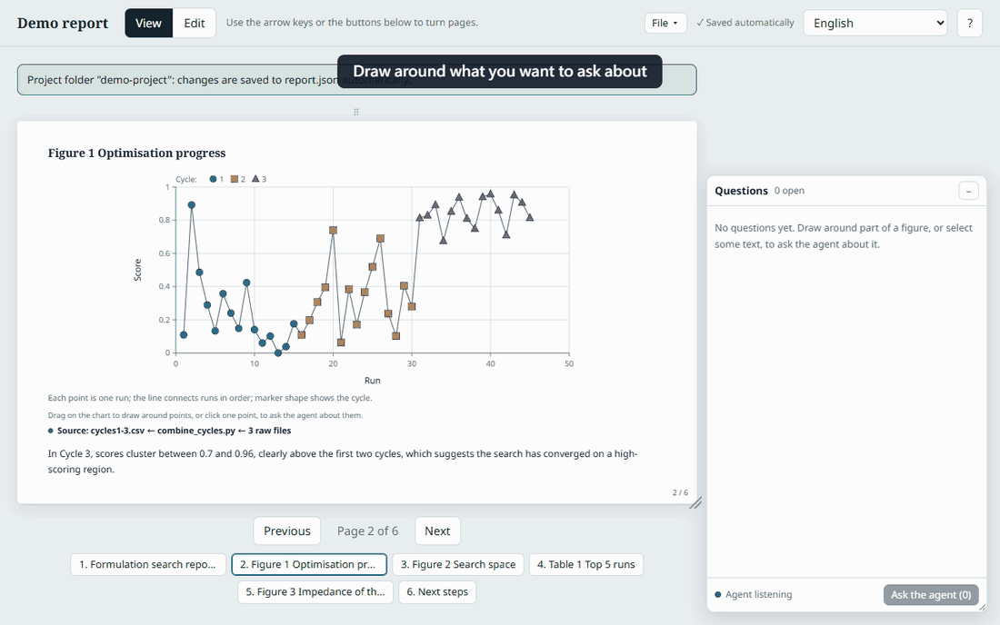
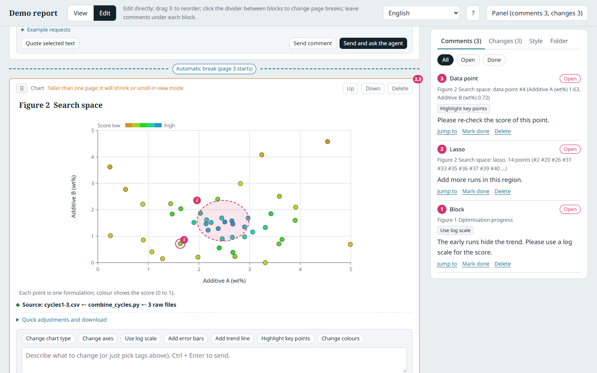
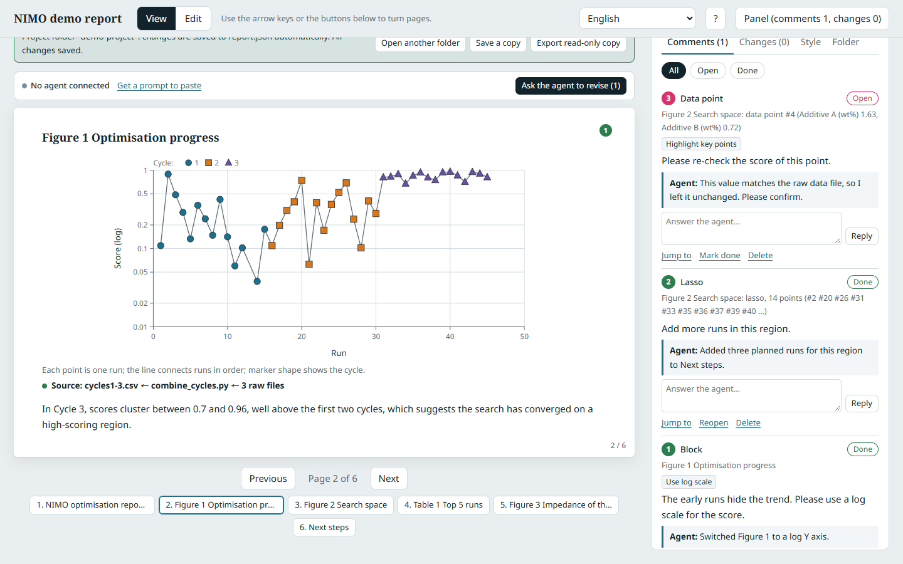
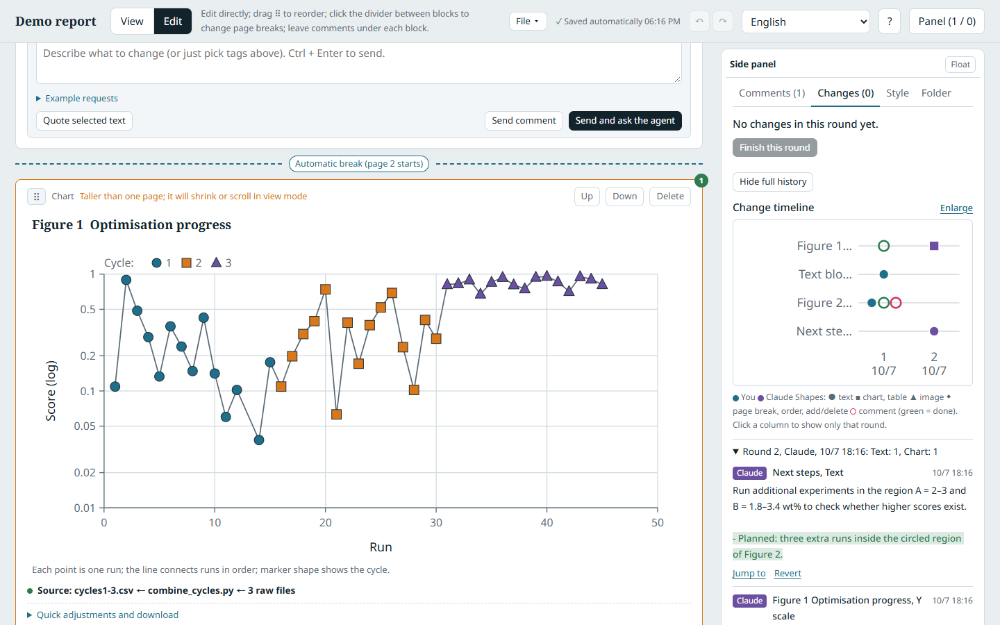
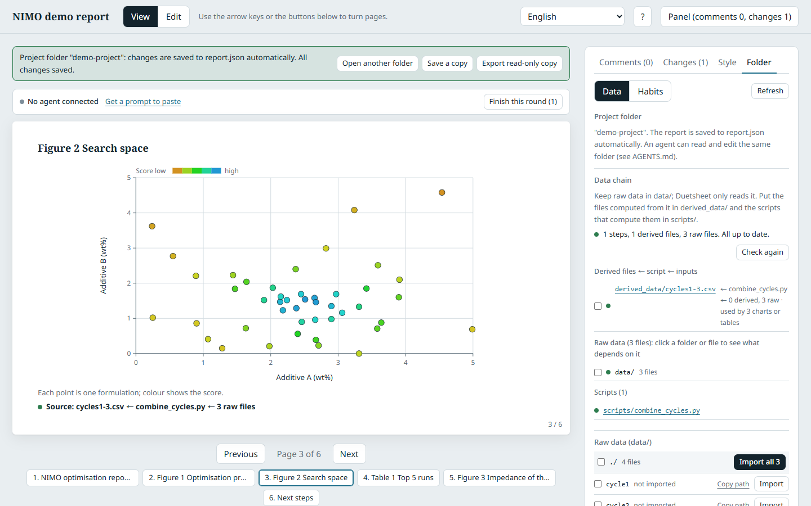
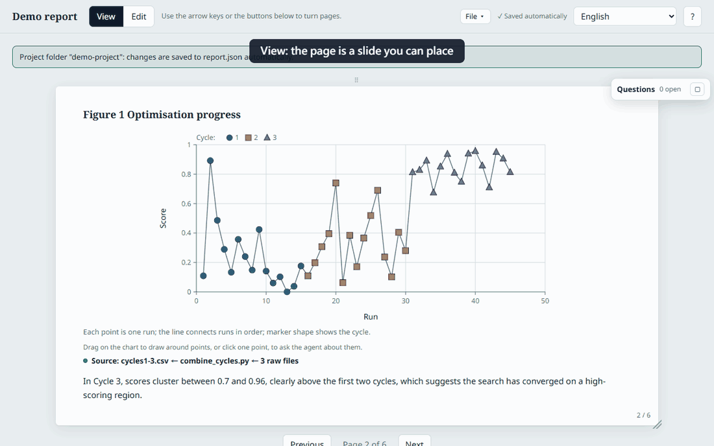
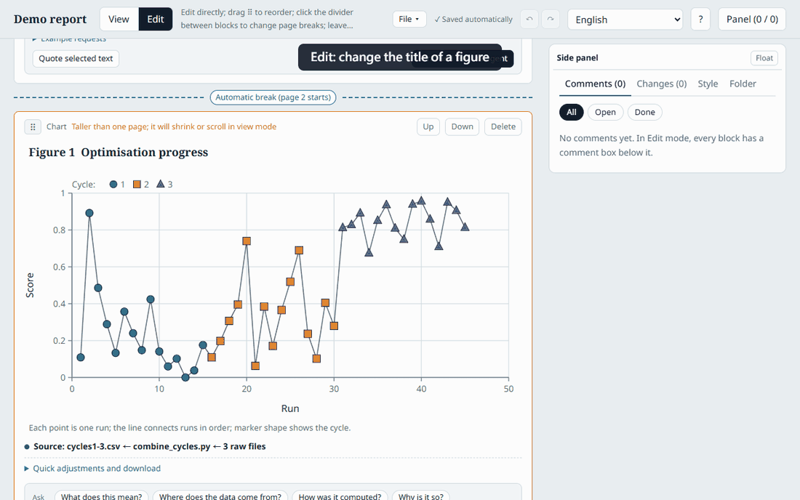
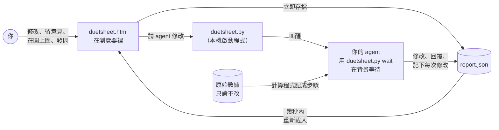

<h1 align="center">Duetsheet</h1>

<p align="center"><b>人和 AI agent 共用的一份樂譜：一起演奏、記下每一步，也能重演。</b><br>你和 AI agent 一輪一輪共同審閱、修改的互動式報告。<br>直接改、在圖上圈、讀到哪問到哪；每一次修改都記下是誰改的。</p>

<p align="center">
  <a href="LICENSE"></a>
  <a href="#安裝"></a>
  <a href="duetsheet.html"></a>
  <a href="#安裝"></a>
  <a href="AGENTS.md"></a>
  <a href="CITATION.cff"></a>
</p>

<p align="center">
  <a href="docs/tutorial.md"></a>
  &nbsp;
  <a href="https://github.com/Ashur5457/duetsheet/archive/refs/heads/main.zip"></a>
  &nbsp;
  <a href="#安裝"></a>
</p>

<p align="center"><a href="README.md">English</a> · <b>繁體中文</b> · <a href="README.ja.md">日本語</a></p>

<p align="center">
  <a href="#快速開始">快速開始</a> ·
  <a href="#畫面">畫面</a> ·
  <a href="#運作方式">運作方式</a> ·
  <a href="#功能">功能</a> ·
  <a href="#安裝">安裝</a> ·
  <a href="#給-agent">給 agent</a> ·
  <a href="#常見問題">常見問題</a> ·
  <a href="#限制">限制</a> ·
  <a href="#路線圖">路線圖</a>
</p>

<p align="center">
  
</p>

<p align="center"><sub>閱讀時發問：圈出兩個點、選一個問題、送出；agent 的回答回到問答側欄。示範專案，數據為合成資料。</sub></p>

---

AI agent 很會寫出「看起來」正確的報告，難的是準確告訴它哪裡不對。在對話框裡寫「第二張圖左上角那群點怪怪的」太模糊，來回幾輪之後，沒人知道哪一版才是最新的。

Duetsheet 用報告本身取代對話框。你直接修改內容、在圖上圈出你指的點，或讀到一段話就直接發問；agent 收到的是精確的數據範圍、資料列編號和修改前後的值，修改後在每則意見下方回覆。每一次修改都記下是誰改的，每張圖都能追回產生它的原始檔和程式。

名稱由來：二重奏（duet）是兩位演奏者看著**同一份樂譜**。在這裡，人和 AI agent 在同一頁上工作；而且就像樂譜一樣，裡面的步驟可以**重新演奏**。

> [!NOTE]
> **v0.7 原型。** 在 Claude Code 輸入 `/duetsheet`，或在數據資料夾執行 `python duetsheet.py` 啟動；也可以用 Chrome 或 Edge 打開 `duetsheet.html` 再選資料夾、放到 [Claude](https://claude.ai) Artifact 上，或在任何瀏覽器使用存下來的報告檔。

> [!TIP]
> **想留下整個研究過程，而不只是報告？** [Duetkifu](https://github.com/Ashur5457/duetkifu) 把走到這份報告的每一次嘗試（包括死路）記成一棵樹，由你和 agent 一起寫，而且可以重新計算。它建立在 Duetsheet 之上，讀的是同一份 `report.json`。

## 快速開始

需要 [Claude Code](https://code.claude.com/docs/en/overview) 和 Python 3.8 以上（不用另外安裝任何套件）：

```text
/plugin marketplace add Ashur5457/duetsheet
/plugin install duetsheet@duetsheet
```

接著在放原始數據的資料夾打開 Claude Code，輸入：

```text
/duetsheet 用這個資料夾裡的數據寫一份報告
```

Claude 會讀 [`AGENTS.md`](AGENTS.md)、先提出大綱，你同意後才寫報告，檢查過再用瀏覽器打開，而且已經連上這個資料夾。審閱完按 **請 agent 修改**，在背景等待的 Claude 會處理你的意見，頁面會自己重新載入。

沒有 Claude Code？桌面版、其他 agent、或完全不用 agent 的做法見[安裝](#安裝)。[教學](docs/tutorial.md)（英文）附截圖，帶你走完一輪。

## 畫面

<table>
  <tr>
    <td width="50%"></td>
    <td width="50%"></td>
  </tr>
  <tr>
    <td><sub><b>指出確切的數據。</b>手繪圈出一些點或點一個點；意見記下的是數據範圍和資料列編號，不是螢幕像素。</sub></td>
    <td><sub><b>agent 回覆。</b>每則意見都有回覆；Figure 1 已改成對數座標，你也可以接著回覆。</sub></td>
  </tr>
  <tr>
    <td></td>
    <td></td>
  </tr>
  <tr>
    <td><sub><b>每一次修改，誰改的。</b>行內差異、回合、時間軸；你的是藍色，agent 的是紫色。</sub></td>
    <td><sub><b>資料鏈。</b>每張圖都能經由產生它的程式追回原始檔，並附檔案指紋。</sub></td>
  </tr>
  <tr>
    <td></td>
    <td></td>
  </tr>
  <tr>
    <td><sub><b>一頁就是一張投影片。</b>可以移動、縮放；不論螢幕大小，每頁放的內容都一樣。</sub></td>
    <td><sub><b>隨時自動存檔。</b>每次改動立即寫入；上一步、下一步可以退回你自己的改動。</sub></td>
  </tr>
</table>

更多畫面在[教學](docs/tutorial.md)裡：[問答側欄](docs/view-ask.png)、[檔案選單](docs/file-menu.png)、[樣式建議](docs/style-panel.png)、[日文介面](docs/language-ja.png)。

## 運作方式



頁面本身從不呼叫 AI 模型。它只是固定的檢視器和編輯器；報告以一般的 JSON 文件存放，任何 agent 都能讀寫：

| 集合 | 內容 |
|---|---|
| `report/meta`、`blocks` | 標題、方塊順序，以及方塊：`text`、`chart`、`table`、`image`、`outline` |
| `datasets` | 數據表和它的來源檔、SHA-256；圖表和表格引用它，而不是複製數值 |
| `annotations` | 你的意見：指向哪裡（方塊、引用的文字、資料點、框選或手繪範圍）、標籤、內容、狀態，以及和 agent 的對話 |
| `changes`、`rounds` | 每個改動的欄位一筆紀錄（修改前、修改後、誰、何時），以及回合的分界 |
| `steps` | 資料鏈：每次執行的程式和它的輸入、輸出檔，讓每個數據表都能追回原始檔 |
| `style`、`examples` | 你的圖表樣式和寫作規則，以及 agent 提出、等你確認的建議 |

同一份文件可以存在資料夾裡的 `report.json`、Claude Artifact 的資料庫，或你存下來的報告檔。因為內容是資料，agent 可以只改一句圖說或一個圖表設定，不必重寫整份報告，每次修改也都能追查、能還原。

## 功能

| | |
|---|---|
| **閱讀** | 16:9 分頁，固定寬度排版、像投影片一樣整張縮放；頁面可以移動、縮放。圖和說明並排；目錄方塊附頁碼。 |
| **閱讀時發問** | 在圖上圈一塊、點一個資料點，或選取一段文字就能發問。問題先放在浮動的問答側欄，一個按鈕一起送出，回答也回到那裡。 |
| **審閱** | 直接修改標題、內文、圖說和圖表設定。每個方塊下方都能留意見，標籤分兩排：詢問（*怎麼算出來的？*）和修改（*改用 log*）。圖表和圖片可以框選或手繪圈選。 |
| **交給 agent** | **請 agent 修改**會叫醒在背景等待的 agent；頁面顯示進度，修改完自動重新載入。沒有 agent 在等時，會給你一段可以貼上的提示詞。 |
| **紀錄** | 每次修改都有修改前後的值，分得出是你還是 agent；行內差異、回合、時間軸；任何一筆都能還原。自己的改動可以上一步、下一步；「檔案」選單可以存快照。 |
| **數據** | 匯入 CSV、TSV、JSON，記下路徑和 SHA-256。資料鏈把每張圖經由程式連到原始檔；任何來源一改，所有由它算出來的東西都會變紅。 |
| **樣式** | 從你自己的 SVG 和 `.mplstyle` 檔學圖表樣式，從你寫過的文章學寫作規則；你打勾之前什麼都不會改。 |
| **給所有人** | 六種介面語言，也能自己加；唯讀副本只有一個 HTML 檔；問題列在 ⚠ 下，也會告訴你的 agent。 |

<details>
<summary><b>完整功能說明</b></summary>

<br>

**審閱**
- **閱覽**：乾淨的 16:9 分頁，自動換頁。任何方塊都能設成「強制新的一頁」「接在上一個方塊下方」或「放在上一個方塊旁邊」，讓圖和說明並排。目錄方塊列出各章節和圖表，附頁碼連結。一頁放不下時圖會自動縮小。頁面固定用同一個寬度排版、整張縮放，所以不論螢幕大小，每頁放的內容都一樣；拖上方細條可以移動頁面，拖右下角可以縮放。
- **閱讀時發問**：在閱覽模式，圈出圖上的一塊、點一個資料點，或選取一段文字，就能詢問 agent。問題（以 `from: "view"` 儲存）先放在浮動的問答側欄，一個按鈕一起送出，回答也回到那裡，可以接著回覆。詢問類標籤（*資料從哪來？*、*怎麼算出來的？*、*可信嗎？*）得到的是回答，不會改報告。
- **編輯**：直接修改標題、內文和圖說；改圖表類型、座標軸、範圍和對數座標；裁切、縮放圖片；拖曳方塊調整順序，或切到 **整理順序（只看標題）**，一頁一頁看每個方塊的標題；新增或刪除方塊。側欄固定在右側，也可以改成浮動。
- **在圖上標註**：像小畫家一樣手繪圈選，或框選，圖表和圖片都可以；也可以點一個資料點。在圖表上，標註記下的是**數據座標範圍和圈到的資料點**，不是像素。
- **用說的，不用調設定**：每個意見框都有 **範例句**，提供一般科學用語的句子讓你改著用（對數座標、座標範圍、多組數據、含 R² 的趨勢線、誤差線、用白話解釋相關性），[…] 是讓你填的地方。在資料夾分頁勾選的檔案可以附上。
- **意見下的對話**：agent 在每則意見下方回覆，你也能接著回；你一回覆，這則意見就重新打開，留到下一輪處理。

**紀錄**
- **修改紀錄**：每次編輯都有修改前後的值；文字顯示成行內差異，設定寫成句子（「Y 軸：線性 → 對數」）。每一筆都能單獨還原。
- **回合與時間軸**：一鍵結束一輪；時間軸以方塊對回合排列，人和 agent 的修改用不同顏色。
- **隨時自動存檔**：每次改動立即寫入，頂列顯示時間；上一步、下一步（Ctrl+Z、Ctrl+Y）可以退回你自己在本輪的改動；「檔案」選單可以把 `report.json` 加上日期存到 `exports/snapshots/`、匯出，以及清除意見（清除前會先存快照）。

**數據與圖**
- **就在你的數據資料夾裡工作**：報告存在 `duetsheet/` 子資料夾；原始數據只讀不改。頁面開著時 agent 也能改報告；頁面會重新載入並以文件為單位合併。
- **原始數據附來源**：每個數據表都記下檔案路徑和 SHA-256 指紋，匯入後檔案若有變動，頁面會告訴你。
- **資料鏈，從圖追到原始檔**：每次執行的程式都記成一個步驟。每張圖下方有一行，例如 *Source: cells.csv ← make_cells.py ← 72 raw files*，點開就是整條鏈。原始檔或程式一改，所有由它算出來的東西都會變紅；符合步驟輸入規則的新檔案會自動被找到。資料夾分頁把每個檔案排成可展開的資料夾，可以篩選檔名，也能反過來問：哪些圖用到了這個原始檔。
- **一張圖放多組數據**、**勾選檔案而不用打檔名**（在資料夾分頁勾選，請 agent 加進圖表或取代圖表的數據），以及**任何工具做的圖**（SVG 保留向量，Origin、matplotlib、MATLAB、R 等輸出的 PNG/JPEG 也行，並記下工具、程式和原始數據）。

**你的風格**
- **樣式設定**：字型、以點為單位的字級、標記大小、線寬、刻度、外框、格線、配色，以及圖寬預設（自由、ACS 單欄、雙欄）。可以匯出成 matplotlib 的 `.mplstyle` 檔。
- **學習你的習慣**：把圖和 `.mplstyle` 放進 `habits/figures/`，把你寫過的文章放進 `habits/writing/`。每項建議都標出依據哪些檔案；存一次成個人習慣，之後每個專案都能載入。

**給所有人**
- **頁面每個部分都有名稱**，列在說明視窗裡，讓你和 agent 講的是同一個東西。
- **看得到的問題**：錯誤和警告列在 **⚠** 下，同時送給你的 agent，並存進 `errors.log`。`NaN` 和 `Infinity` 會當成空值讀入；存檔失敗（例如 OneDrive 正佔用檔案）會自動重試。
- **六種介面語言，也能自己加**：英文、繁體中文、簡體中文、日文、韓文、西班牙文；可以從選單新增或修正翻譯（[做法](docs/translating.md)）。
- **唯讀副本與捷徑**：**檔案 > 匯出唯讀報告**會產生一個在哪都能開的 HTML 檔；`python duetsheet.py shortcut <資料夾>` 會在桌面放一個捷徑。

</details>

## 安裝

只需要 **Python 3.8 以上**，不用其他東西；Duetsheet 從不呼叫 AI 模型，也不需要 API 金鑰。

| 你的環境 | 做法 |
|---|---|
| 在終端機、VS Code 或 JetBrains 裡用 **Claude Code** | `/plugin marketplace add Ashur5457/duetsheet`，然後 `/plugin install duetsheet@duetsheet` |
| **Claude 桌面版**（不能加外掛市集） | `git clone https://github.com/Ashur5457/duetsheet.git && python duetsheet/duetsheet.py install-skill` |
| **其他 agent**（Codex、Copilot、Cursor、Gemini CLI、Cline） | 下載這個 repo，每個數據資料夾執行一次：`python duetsheet.py init-agent "<數據資料夾>"` |
| **不用 agent** | `python duetsheet.py "<數據資料夾>"`，或用 Chrome、Edge 打開 `duetsheet.html`，按 **開啟專案資料夾** |
| **claude.ai 上的 Claude** | 上傳 `duetsheet.html`，請 Claude 把它發布成具備 `db`、`assets`、`sample`、`downloads` 能力的 Artifact |

<details>
<summary><b>檔案放哪裡</b></summary>

<br>

原始數據放在你打開的資料夾**裡面**、但在 `duetsheet/` **外面**，子資料夾隨你分。由它算出來的東西都放進 `duetsheet/`：

```text
my-experiment/                你打開的資料夾
  Data_R1/run001.xlsx         原始數據：留在原處，只讀不改
  notes/instrument.csv
  duetsheet/                  Duetsheet 建立的
    report.json               報告
    derived_data/cells.csv    由原始數據算出的表格
    scripts/make_cells.py     計算它們的程式
    exports/snapshots/        你存的快照
```

放在打開的資料夾以外的數據無法追溯；請先移進來或複製進來。

</details>

<details>
<summary><b>更新、移除，或不用 git 安裝</b></summary>

<br>

- **外掛**：用 `/plugin marketplace update duetsheet` 更新後開新的對話；用 `/plugin uninstall duetsheet@duetsheet` 移除。
- **從副本安裝的 skill**：在 `duetsheet` 資料夾執行 `git pull`，再執行一次 `python duetsheet.py install-skill`；刪掉 `~/.claude/skills/duetsheet` 就是移除。
- **沒有 git**：[下載 ZIP](https://github.com/Ashur5457/duetsheet/archive/refs/heads/main.zip)，解壓縮後在資料夾裡執行 `python duetsheet.py install-skill`。
- `init-agent` 會在數據資料夾的 `AGENTS.md` 和 `CLAUDE.md` 加一段有標記的說明；檔案裡其他內容都保留。

</details>

<details>
<summary><b>不用 Python，或用 Firefox、Safari</b></summary>

<br>

用 Chrome 或 Edge 打開 [`duetsheet.html`](duetsheet.html)，按 **開啟專案資料夾**；想試示範，選 [`examples/demo-project`](examples/demo-project)。Firefox 和 Safari 不能從頁面開資料夾：請用啟動程式，或用 **儲存報告檔** 和 **開啟報告檔**。

</details>

## 給 agent

Duetsheet 不呼叫模型。你的 agent 以 JSON 讀寫報告：

| 檔案 | 內容 |
|---|---|
| [`AGENTS.md`](AGENTS.md) | 資料模型、安全寫入 `report.json` 的方法，以及各項工作：依意見修改、回答問題、匯入數據、學習圖表和寫作習慣、寫一份新報告（英文） |
| [`duetsheet.py`](duetsheet.py) | 啟動程式（`python duetsheet.py <資料夾>`）、`check`、記錄資料鏈的 `step`、審閱流程用的 `annotations`、`wait`、`agent-status`，以及 `shortcut`、`init-agent`、`install-skill` |
| [`skills/duetsheet/SKILL.md`](skills/duetsheet/SKILL.md) | Claude Code 的 `/duetsheet` skill |
| [`schema/report.schema.json`](schema/report.schema.json) | 報告的 JSON Schema |
| [`examples/demo-project/`](examples/demo-project/) | 完整的專案資料夾，含一條小資料鏈（合成數據） |
| [`llms.txt`](llms.txt) | 給 LLM 的簡短索引 |

<details>
<summary><b>好用的提示詞</b></summary>

<br>

```text
照 AGENTS.md，用這個資料夾裡的數據檔寫一份 Duetsheet 報告。記下每個數據表的來源，用 duetsheet.py check 檢查，然後啟動 Duetsheet。
```

```text
讀 report.json 裡還沒處理的意見。每一則都做最小的修改，記進 changes，在意見下方回覆，最後結束你這一輪。
```

```text
看我放在 habits/ 的圖，把樣式建議寫進 style/proposal。不要改 style/profile。
```

</details>

## 適合誰

任何「**AI 起草有大量數據的報告，再由專家逐項查核**」的工作：科學數據分析和實驗報告（這個專案的起點是閉迴路材料實驗）、投資研究和稽核底稿、失效分析和品質調查、顧問和市場研究、事實查核、事後檢討和設計審查。如果報告只有文字，文件編輯器的建議模式可能就夠了；當報告裡有**以數據畫成的圖**、每個數字都必須能追溯時，Duetsheet 最有用。

## 常見問題

<details>
<summary><b>需要 Claude 或帳號嗎？</b></summary>

<br>

不需要。在你的電腦上，用啟動程式（任何瀏覽器）或只用 Chrome、Edge，就能把報告存到資料夾，任何能改檔案的 agent 都能接手。Claude Code 和 Claude Artifact 是支援的用法，不是必要條件。

</details>

<details>
<summary><b>我的資料存在哪裡？</b></summary>

<br>

在你的數據資料夾（Duetsheet 自己的檔案在 `duetsheet/` 子資料夾）、你的 Claude Artifact，或你存下來的檔案。Duetsheet 沒有線上服務，不會把任何東西傳出去；啟動程式只在你自己的電腦上監聽（127.0.0.1），而且需要隨機產生的權杖。頁面會從 Google Fonts 載入字型，並從 CDN 載入一個小函式庫（SortableJS）。

</details>

<details>
<summary><b>agent 怎麼知道我指的是哪個資料點？</b></summary>

<br>

你在圖表上點一個點、框選或手繪圈選時，標註記下的是圖表數據單位的範圍，以及圈到的資料列編號，不是螢幕像素。

</details>

<details>
<summary><b>原始檔改了，怎麼知道哪些圖受影響？</b></summary>

<br>

每張圖和表格都有一個代表資料鏈狀態的小圓點：每個檔案都和紀錄一致時是綠色，原始檔、程式或衍生檔有變動時是紅色。在資料夾分頁點一個原始檔或資料夾，就會列出依賴它的東西。`python duetsheet.py check <資料夾>` 也會以警告列出同樣的內容。

</details>

<details>
<summary><b>可以用 Origin、matplotlib、MATLAB 或 R 做的圖嗎？</b></summary>

<br>

可以。上傳 SVG 或 PNG，並記下工具、原始檔、繪圖程式和原始數據。目前在圖片上的框選和圈選是以圖片的相對位置儲存；換算成數據座標列在路線圖上。

</details>

<details>
<summary><b>和 Google 文件、Word 的註解，或 Jupyter、Quarto 有什麼不同？</b></summary>

<br>

文件註解指向文字；Duetsheet 的意見可以指向圖上的資料點和範圍，而且整段審閱歷程都是 agent 能直接處理的結構化資料。Jupyter 和 Quarto 是從程式產生報告；Duetsheet 則是人和 agent 一起審閱、修正報告的地方，不論報告是誰產生的。

</details>

## 限制

- 從頁面直接開資料夾需要 Chrome 或 Edge；用啟動程式則任何現代瀏覽器都可以。以桌面瀏覽器為設計對象。
- 在 Claude Artifact 裡，每份文件約 256 kB、每份報告約 5,000 份文件。沒有素材庫時，上傳的圖片會壓縮到約 230 kB。
- 框選和手繪圈選只能用在圖表和圖片；文字和表格可以對整個方塊留意見或引用文字。
- 頁面無法量測 PNG 和 JPEG 的圖；請 agent 看，或改用 SVG。Excel 和儀器格式的檔案由 agent 轉換，頁面不直接匯入。
- 介面語言不會翻譯報告內容。由右至左的語言可以載入，但版面仍是由左至右。

## 路線圖

- 一鍵匯出「給 LLM 的意見」提示詞
- 在 Claude Artifact 裡從頁面叫醒 agent，不必啟動啟動程式
- 用桌面捷徑啟動的 agent，讓 **請 agent 修改** 不必貼提示詞也能運作
- 依來源重新產生圖：執行記錄下來的程式，或透過 Python API 操作 Origin
- 匯入圖片的座標校準，讓 Origin 或 matplotlib 圖上的圈選以數據座標儲存
- **工作流程模式**：從頁面重新執行需要重算的步驟
- 自動化實驗室裡的實體實驗步驟，必須經人明確同意才執行
- 把意見和修改紀錄整理成評估 agent 的測試集

研究的分支、死路和每一次嘗試的紀錄，在 [Duetkifu](https://github.com/Ashur5457/duetkifu)。

## 參與貢獻

歡迎提 issue 和 pull request，特別是其他領域的報告類型、標註需求，以及翻譯。英文以外的介面文字，以及中文版和日文版 README，是在 AI 協助下起草的：非常歡迎母語者指正。

- `duetsheet.html` 是唯一的原始碼檔，沒有建置步驟：直接修改，用瀏覽器打開即可。
- 新的介面文字寫成 `tr('English text')`，並要在翻譯表加上翻譯（[docs/translating.md](docs/translating.md)）。修改英文 README 時，[`README.zh-Hant.md`](README.zh-Hant.md) 和 [`README.ja.md`](README.ja.md) 也要一起改。
- 送 pull request 前，請執行 `python tools/check.py`（程式碼為英文、翻譯表有效、用 Node.js 檢查 JavaScript 語法）、`python tests/test_chain.py` 和 `python tests/test_agent.py`。測試只用暫存資料夾和示範專案，不會碰你的數據。

## 引用

如果在研究中使用 Duetsheet，請依 [`CITATION.cff`](CITATION.cff) 引用（GitHub 頁面上有「Cite this repository」按鈕）。

## 授權

[MIT](LICENSE)
